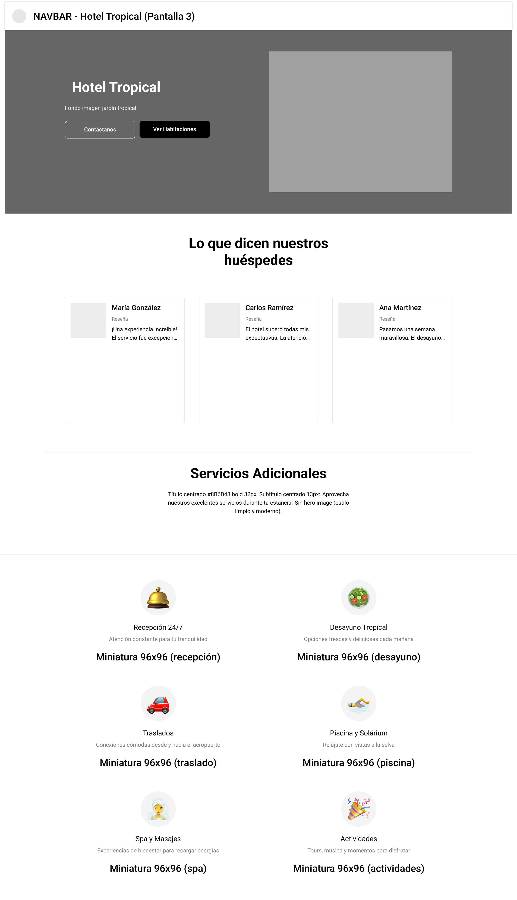
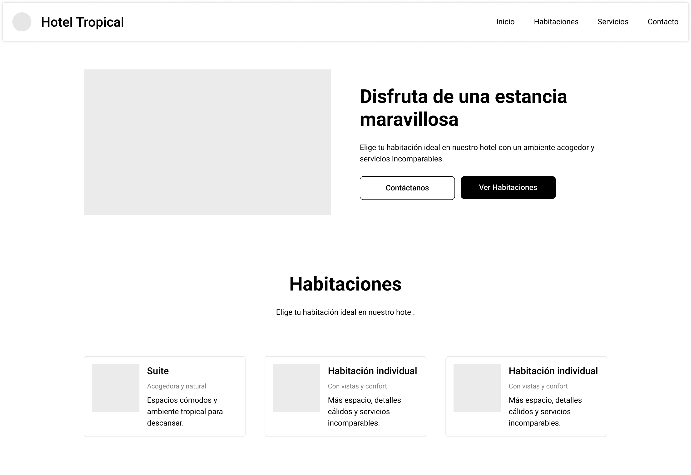
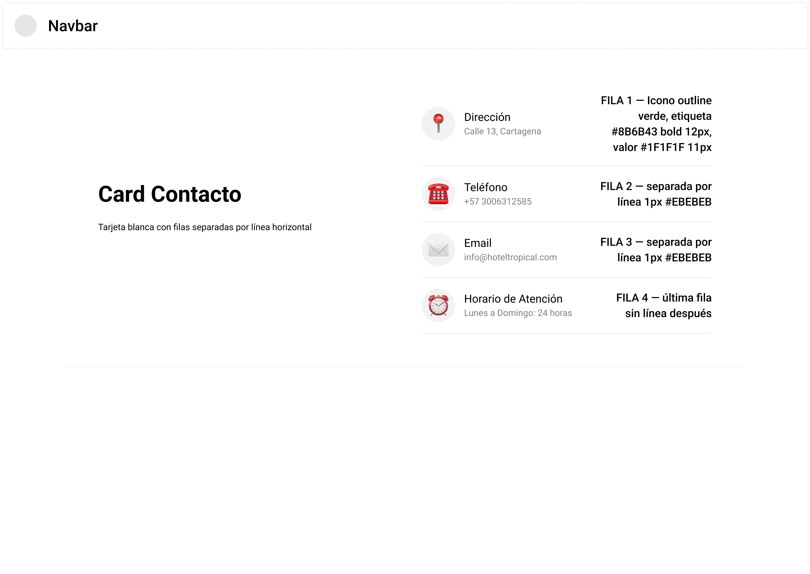

# Hotel Tropical

Aplicación web para la gestión de reservas del Hotel Tropical, desarrollada con Angular.

---

## Diseño (mockups)

Archivo de diseño en Figma: [Hotel Tropical – Figma](https://www.figma.com/design/SYRrJtutlKevkglQa6udOf/hotel-tropical?node-id=0-1&p=f&t=c3bKr89CEKNEdGU2-0)

### 01 · Pantalla de Inicio
Hero con imagen de fondo, botones de acción y sección de opiniones de huéspedes.

### 02 · Servicios Adicionales
Tarjetas con los servicios disponibles: recepción, desayuno, traslados, piscina, spa y actividades.

### 03 · Contáctanos
Formulario de contacto e información del hotel.

